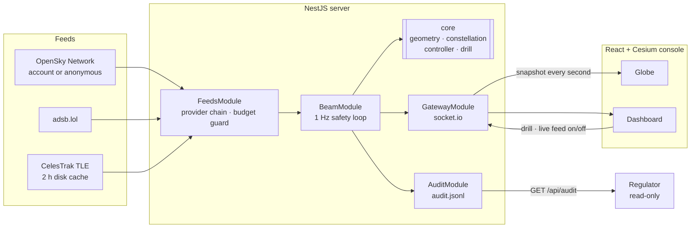

# ⚡ Beam Control

**Air traffic control for space-based solar power.** IEEE LUMEN 2.0 · Beyond 2030.

By the 2040s, constellations of low-orbit satellites could beam solar power down to ground receivers. Those beams move, hand off between satellites every few minutes, and share the sky with aircraft and other satellites.

Beam Control predicts when a **live** aircraft or satellite is about to cross a beam. It hands the receiver to a clean satellite before contact (or throttles the beam if there is none), keeps the city's power flowing, and records every decision in an audit log.

> **Honesty rule.** The power satellites, receivers and drill intruders are **SIMULATED** and labelled that way on screen. The aircraft (OpenSky / adsb.lol) and satellites (CelesTrak) they avoid are real, live data.

## Architecture

The server owns the truth: one safety loop for every receiver, running whether or not anyone has the console open. Every screen is a viewer.



| Part | Technology | Why it is here |
|---|---|---|
| Safety core | Plain TypeScript, no framework | Small, explainable, unit-tested; runs anywhere |
| Orbits | satellite.js (SGP4) | Same propagator for real (CelesTrak) and simulated satellites |
| Server | NestJS 11 | One module per job; the loop keeps running without a browser; clear places for persistence, auth and roles |
| Realtime | socket.io | Push one snapshot per second to every open screen |
| Console | React 19 + Vite + CesiumJS | Dashboard as components; 3D globe for beams in orbit |

## What we built vs. what we use

| Built by us | Used (credited) |
|---|---|
| Beam geometry and intrusion prediction (`server/src/core/geometry.ts`) | CesiumJS: 3D globe engine |
| Simulated power constellation and receivers (`constellation.ts`) | satellite.js: SGP4 orbit propagation |
| Throttle and handoff controller, audit log, safety metrics (`controller.ts`) | NestJS, React, Vite, socket.io |
| Drill intruder (`drill.ts`) | CelesTrak: satellite orbital elements |
| Feed provider chain, budget guard, caches (`server/src/feeds`) | OpenSky Network and adsb.lol: live aircraft |
| Aircraft tracker, beam loop, audit API, gateway (`server/src`) | Esri World Imagery: base map |
| Console: globe scene, dashboard, fly-to (`web/src`) | |

## The core math

- **Satellite position:** SGP4 from two-line elements. The simulated constellation is a Walker-delta of 12 planes × 8 satellites at 1,200 km, 53°.
- **Beam:** a segment from the satellite's position to the receiver, in Earth-centred, Earth-fixed metres. The satellite end moves.
- **Prediction:** each object is projected forward as P(t) = P₀ + v·t, sampled every second up to 60 s. A predicted intrusion is the first sample inside the beam type's safety radius (laser 2 km, microwave 600 m). A bounding-box broad phase runs before the exact distance test.
- **Handoff:** pick a satellite above 15° elevation, with no predicted intrusion, not serving another receiver and not about to set, with the longest remaining pass. Crossfade over 5 s so delivery stays flat.
- **Throttle:** with no clean satellite, hold power until 10 s before contact, ramp to zero, and restore once the object is clear.
- **Safety number:** `contacts` counts every tick an object is inside a powered beam. It must stay 0, and the tests assert it.

## Run it

Requires Node 24.

```bash
npm install
npm run dev
```

Open http://localhost:5173. The console flies to London West. Press **Run drill** to send a SIMULATED intruder across the beam, or switch **Live feed** on for real traffic.

The live feed is off by default to save the free providers' daily budget. For a larger budget, create a free OpenSky Network API client and copy `server/.env.example` to `server/.env`:

```bash
OPENSKY_CLIENT_ID=...
OPENSKY_CLIENT_SECRET=...
```

**Regulator view:** `GET http://localhost:3000/api/audit?limit=50` returns every intervention, newest first, read-only. `GET /api/state` returns the latest snapshot.

**Tests:**

```bash
npm test
```

## Known limitations and next steps

- Straight-line prediction. Flight plans and vertical rate would improve accuracy.
- Free flight feeds have daily limits and gaps over oceans. Production would use a licensed ADS-B feed plus satellite ADS-B.
- No weather model yet. Clouds block laser beams, so a weather layer feeding the handoff rule is next.
- Next platform steps: a database for the audit trail, operator login and roles (operator, regulator, grid operator), and multiple constellations and operators.
- The next frontier is the Moon: bases in the permanently dark craters at the lunar south pole will need beamed power, and the same logic carries over.
